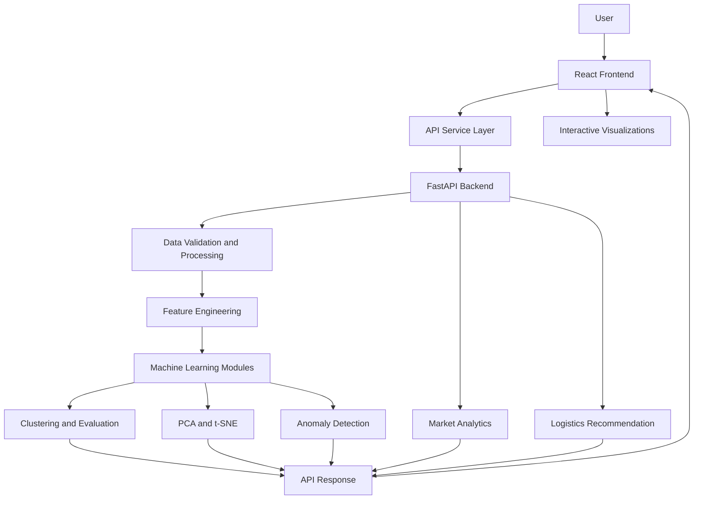

# 🌾 MandiCluster
### Agricultural Market Segmentation & Price-Pattern Intelligence Platform

**Discover Markets. Understand Prices. Make Informed Decisions.**

<p align="center">
  An ML-powered agricultural market intelligence platform that helps farmers and analysts understand price patterns, discover similar agricultural markets, detect unusual price movements, and compare potential selling destinations.
</p>

<p align="center">
  <a href="https://mandi-cluster.vercel.app/">Live Demo</a> •
  <a href="https://github.com/Sparsshgpt/MandiCluster">GitHub Repository</a>
</p>

---

## 📌 Overview

Agricultural market prices fluctuate across different mandis due to variations in demand, supply, arrivals, geographical conditions, and market activity. Farmers often find it difficult to identify suitable markets, understand historical price movements, and compare selling opportunities.

**MandiCluster** is a machine-learning-based agricultural market intelligence platform designed to address these challenges.

The application uses unsupervised machine learning techniques and statistical analysis to identify patterns in agricultural market data. It groups mandis with similar price behaviour, evaluates clustering quality, visualizes market relationships, detects unusual price observations, and provides logistics-adjusted market recommendations.

The platform combines a modern React frontend with a Python FastAPI backend to deliver an interactive analytical experience.

## 🎯 Project Objectives

- Analyze historical agricultural commodity prices.
- Identify similarities between different agricultural markets.
- Group mandis based on statistical price patterns.
- Compare clustering algorithms and evaluate their performance.
- Visualize complex market relationships using dimensionality reduction.
- Detect unusual price movements and market anomalies.
- Compare potential selling destinations after considering transportation costs.
- Provide an interactive interface for exploring agricultural market intelligence.

## ✨ Key Features

### 1. Agricultural Market Analytics

Analyze agricultural market data using multiple statistical indicators.

- Average modal price
- Minimum and maximum observed prices
- Standard deviation
- Coefficient of variation (CV%)
- Historical price trends
- Market-wise price rankings
- Commodity distribution
- Recent market observations

### 2. Intelligent Market Clustering

Discover groups of mandis with similar agricultural price behaviour using four clustering algorithms.

| Algorithm | Purpose |
|---|---|
| K-Means | Partitions markets into K clusters |
| MiniBatch K-Means | Performs computationally efficient clustering |
| Hierarchical Agglomerative | Identifies hierarchical market relationships |
| DBSCAN | Identifies density-based clusters and noise points |

Market feature vectors can include:

- Mean price
- Median price
- Standard deviation
- Coefficient of variation
- Price trend slope
- Average market arrivals

### 3. Clustering Evaluation

Evaluate clustering quality using statistical validation techniques.

- **Elbow Method / WCSS:** Helps identify a suitable number of clusters.
- **Silhouette Score:** Measures how well observations fit their assigned clusters.
- **Davies-Bouldin Index:** Evaluates cluster separation and compactness.

These metrics help compare clustering configurations and understand the quality of the resulting groups.

### 4. Dimensionality Reduction

Visualize high-dimensional market feature vectors in a two-dimensional space.

**Principal Component Analysis (PCA)**
- Linear dimensionality reduction.
- Preserves directions of maximum variance.
- Helps visualize relationships between markets.

**t-SNE**
- Non-linear dimensionality reduction.
- Helps reveal local similarities and patterns.
- Provides an alternative visualization of market groupings.

Both techniques are used to explore market relationships through visual comparisons.

### 5. Price Anomaly Detection

Identify unusual agricultural price observations using:

- Isolation Forest
- Local Outlier Factor (LOF)

The anomaly detection module helps highlight unusual price behaviour and observations that may require further investigation.

### 6. Market Comparison

Compare multiple mandis for a selected agricultural commodity.

The analysis includes:

- Average modal prices
- Latest recorded prices
- Minimum and maximum prices
- Price variability
- Average arrivals
- Historical price comparisons
- Market-wise statistical indicators

### 7. Logistics-Based Market Recommendations

A market offering a higher selling price does not always provide the highest final return.

MandiCluster includes a logistics-based recommendation module that considers:

- Origin market
- Destination market
- Commodity
- Quantity in quintals
- Vehicle type
- Transportation cost
- Loading cost
- Maximum travel distance

It calculates freight-adjusted net proceeds to help compare potential selling destinations.

### 8. CSV Data Upload and Validation

Users can upload their own agricultural market datasets.

The backend provides:

- CSV file validation
- Column standardization
- Data cleaning
- Validation reports
- Dataset metadata
- Data provenance information

A successfully validated dataset becomes the active dataset for subsequent analytical requests within the running backend instance.

### 9. Multilingual Interface

The frontend includes internationalization support for:

- English
- Hindi
- Punjabi

This makes the platform more accessible to users with different language preferences.

---

## 🧠 Machine Learning Methodology

MandiCluster follows an unsupervised learning pipeline to discover patterns in agricultural market data.

### Workflow

1. **Data Collection:** Load the default agricultural market dataset or upload a custom CSV file.
2. **Data Validation:** Validate columns, standardize data and handle data quality issues.
3. **Feature Engineering:** Extract statistical features from market price and arrival information.
4. **Feature Scaling:** Apply the selected scaling method before clustering.
5. **Clustering:** Run the selected clustering algorithm.
6. **Model Evaluation:** Evaluate cluster quality using validation metrics.
7. **Dimensionality Reduction:** Apply PCA and t-SNE for visual exploration.
8. **Anomaly Detection:** Identify unusual observations.
9. **Market Recommendation:** Calculate freight-adjusted net proceeds for potential destinations.

### Machine Learning Components

| Category | Techniques |
|---|---|
| Clustering | K-Means, MiniBatch K-Means, Agglomerative, DBSCAN |
| Evaluation | WCSS, Silhouette Score, Davies-Bouldin Index |
| Dimensionality Reduction | PCA, t-SNE |
| Anomaly Detection | Isolation Forest, LOF |
| Statistical Analysis | Mean, Median, Standard Deviation, CV%, Trend Slope |

---

## 🏗️ System Architecture

The application follows a frontend-backend architecture.



### Architecture Explanation

**Frontend Layer**
- Built using React and TypeScript.
- Provides interactive dashboards and analytical interfaces.
- Communicates with the backend through a centralized API service.

**Backend Layer**
- Built using FastAPI.
- Handles API requests, dataset validation and analytical operations.
- Uses Pydantic for request and response validation.

**Machine Learning Layer**
- Implements clustering, evaluation, dimensionality reduction and anomaly detection.
- Uses Scikit-learn, NumPy, Pandas and SciPy.

**Visualization Layer**
- Presents analytical results through interactive frontend visualizations.

---

## 🛠️ Technology Stack

### Frontend

| Technology | Usage |
|---|---|
| React 18 | User interface |
| TypeScript | Type-safe development |
| Vite | Frontend build tool |
| Tailwind CSS | Styling |
| Recharts | Data visualization |
| Lucide React | Icons |
| React Router | Application navigation |
| i18next | Multilingual support |
| PapaParse | CSV parsing |

### Backend

| Technology | Usage |
|---|---|
| Python 3.11 | Backend development |
| FastAPI | REST API development |
| Pydantic | Data validation |
| Uvicorn | ASGI server |
| Python Multipart | File upload handling |

### Machine Learning and Data Analysis

| Library | Usage |
|---|---|
| NumPy | Numerical computations |
| Pandas | Data processing |
| Scikit-learn | Machine learning algorithms |
| SciPy | Scientific computing |

### Deployment and Development

- Git and GitHub
- Visual Studio Code
- Vercel
- npm
- Python Virtual Environment

---

## 📂 Project Structure

```text
MandiCluster/
│
├── api/
│   ├── index.py
│   │
│   ├── schemas/
│   │   └── models.py
│   │
│   ├── data/
│   │   ├── agmarknet_sample.csv
│   │   └── ingestion.py
│   │
│   └── ml/
│       ├── features.py
│       ├── clustering.py
│       ├── evaluation.py
│       ├── dim_reduction.py
│       ├── anomaly.py
│       └── recommendation.py
│
├── public/
│
├── scripts/
│
├── src/
│   ├── components/
│   ├── pages/
│   ├── i18n/
│   ├── services/
│   │   └── api.ts
│   └── types/
│       └── index.ts
│
├── tests/
│   └── test_backend.py
│
├── .gitignore
├── index.html
├── package.json
├── package-lock.json
├── requirements.txt
├── postcss.config.js
├── tailwind.config.js
├── tsconfig.json
├── tsconfig.node.json
├── vercel.json
└── vite.config.ts
```

---

## 📊 Dataset

The project includes a sample agricultural market dataset:

`api/data/agmarknet_sample.csv`

The dataset contains 4,482 sample records, as documented in the project.

It represents Indian agricultural market observations and is used for exploring price patterns and market relationships.

### Important Data Attributes

The backend works with standardized columns including:

| Column | Description |
|---|---|
| Date | Market observation date |
| State | State of the market |
| District | District in which the market is located |
| Market | Mandi or agricultural market name |
| Commodity | Agricultural commodity |
| Modal_Price | Modal market price |
| Min_Price | Minimum recorded price |
| Max_Price | Maximum recorded price |
| Arrivals_Tonnes | Quantity of arrivals in tonnes |

The application also supports user-uploaded CSV datasets through its validation endpoint.

---

## ⚙️ Installation and Local Setup

Follow these steps to run MandiCluster locally.

### Prerequisites

Install the following:

- Node.js and npm
- Python 3.11
- Git
- Visual Studio Code (recommended)

### Step 1: Clone the Repository

```bash
git clone https://github.com/Sparsshgpt/MandiCluster.git
```

Navigate into the project:

```bash
cd MandiCluster
```

### Step 2: Set Up the Python Backend

Create a virtual environment:

```bash
python -m venv venv
```

Activate it.

**Windows:**

```bash
venv\Scripts\activate
```

**Linux / macOS:**

```bash
source venv/bin/activate
```

Install backend dependencies:

```bash
pip install -r requirements.txt
```

### Step 3: Start the Backend

Run the FastAPI development server:

```bash
python -m uvicorn api.index:app --reload --port 8000
```

The backend will be available at:

```text
http://localhost:8000
```

Interactive API documentation:

```text
http://localhost:8000/docs
```

### Step 4: Set Up the Frontend

Open another terminal in the project directory.

Install frontend dependencies:

```bash
npm install
```

### Step 5: Start the Frontend

```bash
npm run dev
```

The frontend will be available at:

```text
http://localhost:3000
```

The Vite development server proxies `/api` requests to the local FastAPI backend at port 8000.

### Step 6: Run Backend Tests

With the Python virtual environment activated:

```bash
python tests/test_backend.py
```

---

## 🔌 API Documentation

MandiCluster provides REST API endpoints through FastAPI.

The frontend communicates with the backend using a centralized API service.

### Main API Endpoints

| Method | Endpoint | Description |
|---|---|---|
| GET | `/api/health` | Check backend health |
| GET | `/api/metadata` | Retrieve dataset metadata |
| POST | `/api/data/validate` | Upload and validate CSV data |
| POST | `/api/market/summary` | Generate market analytics |
| POST | `/api/market/compare` | Compare multiple markets |
| POST | `/api/clustering/run` | Execute clustering algorithms |
| POST | `/api/clustering/evaluate` | Evaluate clustering configurations |
| POST | `/api/dimensionality-reduction/pca` | Generate dimensionality reduction comparison |
| POST | `/api/anomaly-detection/run` | Detect price anomalies |
| POST | `/api/recommendations/compare` | Generate logistics-adjusted recommendations |

### API Documentation

When running locally, access:

```text
http://localhost:8000/docs
```

This provides interactive documentation for testing API endpoints and understanding request and response schemas.

---

## 🚀 Deployment on Vercel

MandiCluster is configured for deployment on Vercel using a single repository.

### Deployment Configuration

The project uses:

- Framework: Vite
- Build Command: `npm run build`
- Output Directory: `dist`
- Backend Entry Point: `api/index.py`
- Deployment Configuration: `vercel.json`

### Deployment Steps

1. Push the project to GitHub.
2. Log in to Vercel.
3. Select **Add New Project**.
4. Import the MandiCluster repository.
5. Configure the build settings.
6. Deploy the application.
7. Verify frontend and backend API functionality.

### Production URLs

**Live Application:**

https://mandi-cluster.vercel.app/

**GitHub Repository:**

https://github.com/Sparsshgpt/MandiCluster

### Serverless Deployment Considerations

The backend uses Python serverless functions.

Important considerations:

- Serverless functions are stateless between invocations.
- Uploaded datasets are maintained in an in-memory cache and are not guaranteed to persist between function instances.
- Cold starts can increase the response time of the first request.
- Python dependencies such as NumPy, SciPy, Pandas and Scikit-learn contribute significantly to deployment bundle size.
- Execution time and deployment bundle limits depend on the Vercel plan and function configuration.

For larger datasets or heavier ML workloads, a separately hosted Python backend may be a more suitable architecture.

---

## 🔒 Data Handling and Limitations

- The included dataset is sample data and should not be treated as a live agricultural price feed.
- Market recommendations are analytical estimates, not guaranteed selling outcomes.
- Transportation and loading costs influence the calculated net proceeds.
- Uploaded datasets are subject to the backend's validation requirements.
- Uploaded data stored in serverless memory is not permanent storage.
- Clustering results depend on the selected algorithm, features, scaling method and parameters.
- Anomaly detection identifies unusual observations; it does not independently establish their causes.

---

## 🔮 Future Enhancements

Potential improvements to make the platform more comprehensive:

- Integration with live Agmarknet agricultural market data.
- Real-time commodity price monitoring.
- Advanced time-series price forecasting.
- Weather-based agricultural market analysis.
- Geographic market visualization using interactive maps.
- More advanced recommendation algorithms.
- Persistent cloud storage for uploaded datasets.
- Background processing for large ML workloads.
- User authentication and personalized dashboards.
- Mobile-friendly farmer dashboard.
- Additional regional language support.

---

## 🎓 Learning Outcomes

This project demonstrates practical implementation of:

- Unsupervised machine learning.
- Statistical feature engineering.
- Clustering algorithms and validation.
- Dimensionality reduction.
- Anomaly detection.
- Data cleaning and preprocessing.
- REST API development using FastAPI.
- Frontend development using React and TypeScript.
- Interactive data visualization.
- Full-stack application integration.
- Cloud deployment using Vercel.

---

## 👨‍💻 Author

**Sparsh Gupta**

B.Tech – Computer Science and Engineering (AI & ML)

- GitHub: https://github.com/Sparsshgpt
- Project Repository: https://github.com/Sparsshgpt/MandiCluster
- Live Application: https://mandi-cluster.vercel.app/

---

## ⭐ Support

If you find MandiCluster interesting or useful, consider giving the repository a star on GitHub.

Your support and feedback are appreciated!

---

<p align="center">
  <b>MandiCluster — Discover Markets. Understand Prices. Make Informed Decisions.</b>
</p>
